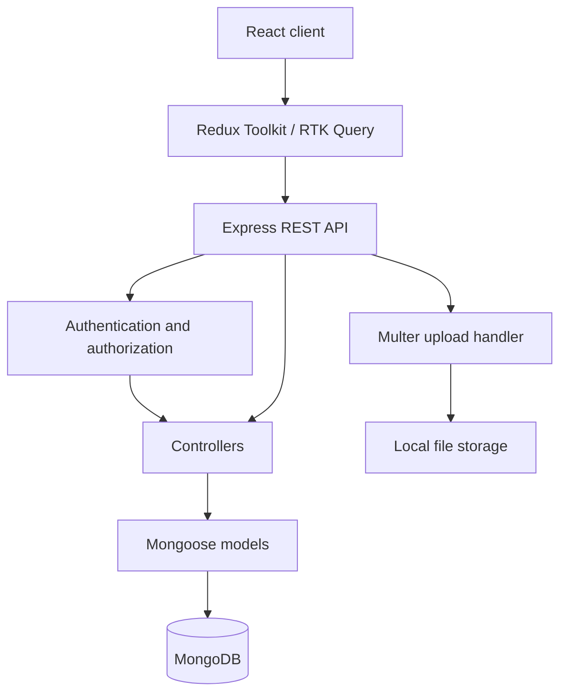
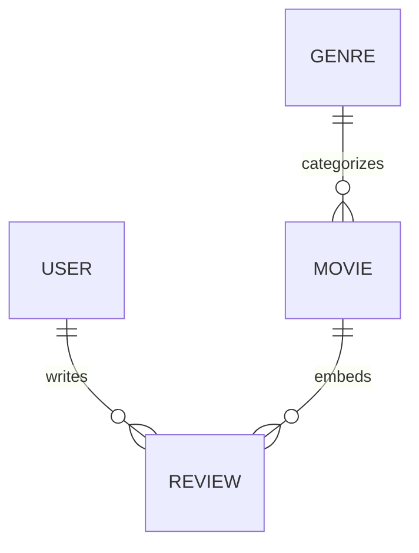

# MERN Movie App


## Overview

A full-stack movie discovery and management platform built with MongoDB, Express, React and Node.js. Users can browse movies, watch trailers, submit reviews and manage their profiles. An administrative dashboard supports movie and genre management and review moderation.

### Project highlights

- 22 REST API endpoints across four route modules.
- Three Mongoose models and embedded review documents.
- Two user roles, with server-side authorization for administrative operations.
- JWT authentication via HttpOnly cookies and centralized frontend state using Redux Toolkit and RTK Query.
- Modular routes, controllers, models, middleware and utilities.

## Features

**Users:** Registration, login, logout, movie browsing and filtering, cast and release information, trailers, ratings, reviews, duplicate review detection and profile management.

**Administrators:** Dashboard, movie and genre CRUD, review moderation, user listing and poster uploads. Administrative movie and genre operations are protected by backend middleware.

## Technology stack

| Layer | Technologies |
|---|---|
| Frontend | React 19, JavaScript, Vite, React Router 7 |
| Styling | Tailwind CSS 4 |
| State and API | Redux Toolkit, RTK Query |
| Backend | Node.js, Express 5 |
| Persistence | MongoDB, Mongoose 9 |
| Authentication | JWT, bcryptjs, HttpOnly cookies |
| Uploads | Multer, local disk |
| Development | Nodemon, Concurrently, ESLint |

## Architecture



The frontend communicates with versioned REST endpoints. During development, Vite proxies API and uploaded image requests to port 3000.

## Database design



| Model | Key fields |
|---|---|
| User | username, unique email, password, isAdmin, timestamps |
| Movie | name, image, year, genre reference, detail, cast, reviews, numReviews, trailer, timestamps |
| Genre | Movie category |
| Review (embedded) | name, user reference, rating, comment, timestamps |

Reviews are embedded in movie documents, simplifying retrieval of movie details and associated reviews. A separate collection could be preferable at larger review volumes.

## Authentication and authorization

JWTs are issued after authentication and stored in HttpOnly cookies with SameSite Strict and a 30-day lifetime. The Secure flag is enabled outside development. Password hashing uses bcryptjs. Protected requests pass through authentication middleware; administrative routes additionally check the user's role.

## REST API reference

Base URL: `http://localhost:3000/api/v1`

| Method | Endpoint | Access |
|---|---|---|
| POST | /users | Public |
| POST | /users/auth | Public |
| POST | /users/logout | Public |
| GET | /users | Admin |
| GET | /users/profile | User |
| PUT | /users/profile | User |
| GET | /movies/all-movies | Public |
| GET | /movies/specific-movie/:id | Public |
| GET | /movies/new-movies | Public |
| GET | /movies/top-movies | Public |
| GET | /movies/random-movies | Public |
| POST | /movies/:id/reviews | User |
| POST | /movies/create-movie | Admin |
| PUT | /movies/update-movie/:id | Admin |
| DELETE | /movies/delete-movie/:id | Admin |
| DELETE | /movies/delete-comment | Admin |
| GET | /genre/genres | Public |
| GET | /genre/:id | Public |
| POST | /genre | Admin |
| PUT | /genre/:id | Admin |
| DELETE | /genre/:id | Admin |
| POST | /upload | Public |

The upload endpoint accepts multipart/form-data using an image field and stores files locally.

### Example requests

```bash
curl http://localhost:3000/api/v1/movies/all-movies

curl -c cookies.txt -X POST http://localhost:3000/api/v1/users/auth \
  -H "Content-Type: application/json" \
  -d '{"email":"user@example.com","password":"your-password"}'

curl -b cookies.txt -X POST http://localhost:3000/api/v1/movies/MOVIE_ID/reviews \
  -H "Content-Type: application/json" \
  -d '{"rating":5,"comment":"Great movie!"}'
```

Replace MOVIE_ID with an existing movie document ID.

## Engineering decisions

- **Separation of concerns:** Routes, controllers, middleware and persistence models are organized into dedicated modules.
- **Embedded reviews:** Movie details and reviews can be retrieved together.
- **State management:** Redux Toolkit and RTK Query centralize shared state, API requests and caching.
- **Movie discovery:** Recently added movies (up to 20), popular movies (up to 10, sorted by review count), and random selection using MongoDB's $sample aggregation stage (up to 10).
- **Authorization:** Administrative operations are enforced on the server, not solely through frontend route restrictions.

## Project structure

```text
MERN-Movie-app/
├── backend/
│   ├── config/
│   ├── controllers/
│   ├── middlewares/
│   ├── models/
│   ├── routes/
│   ├── utils/
│   └── index.js
├── frontend/
│   ├── src/
│   │   ├── assets/
│   │   ├── component/
│   │   ├── pages/
│   │   │   ├── Admin/
│   │   │   ├── Auth/
│   │   │   ├── Movies/
│   │   │   └── User/
│   │   ├── redux/
│   │   ├── App.jsx
│   │   └── main.jsx
│   ├── package.json
│   └── vite.config.js
├── uploads/
├── package.json
└── README.md
```

## Getting started

Prerequisites: Git, Node.js 22.12+ (recommended), npm and a local or hosted MongoDB instance.

```bash
git clone https://github.com/Claudio1009/MERN-Movie-app.git
cd MERN-Movie-app
npm install
cd frontend
npm install
cd ..
```

Create a `.env` file in the repository root:

```dotenv
PORT=3000
MONGO_URL=mongodb://127.0.0.1:27017/movie_app
JWT_SECRET=replace_with_a_long_random_secret
NODE_ENV=development
```

Never commit credentials or secrets.

Start both services from the repository root:

```bash
npm run fullstack
```

Frontend: http://localhost:5173  
Backend: http://localhost:3000

Alternatively, run `npm run backend` and `npm run frontend` in separate terminals.

## Code quality

```bash
cd frontend
npm run lint
npm run build
```

Automated backend unit and integration tests are not currently included.

## Current limitations and roadmap

- Add automated unit and integration tests.
- Add server-side pagination, filtering and database indexes.
- Strengthen request and upload validation, require upload authentication and enforce file size limits.
- Add rate limiting and cloud-based image storage.
- Persist average ratings in the movie schema.
- Make duplicate review prevention atomic.
- Add Docker, OpenAPI documentation and CI/CD.

These are future improvements, not implemented features. This project is a development portfolio application, not a production-ready service.

## Author

Claudiu Marius Ciupitu — [GitHub](https://github.com/Claudio1009)
